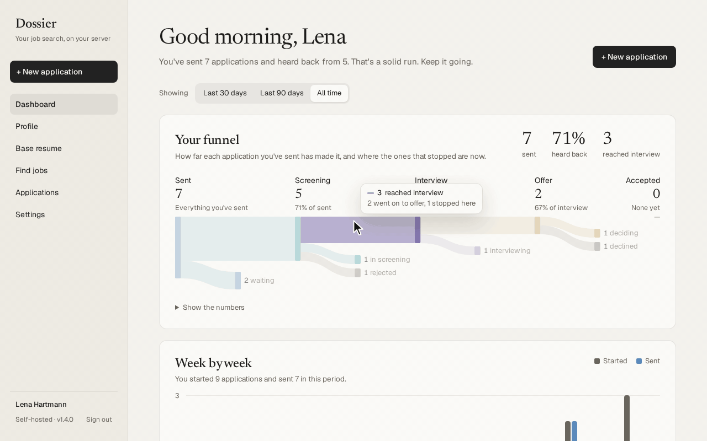
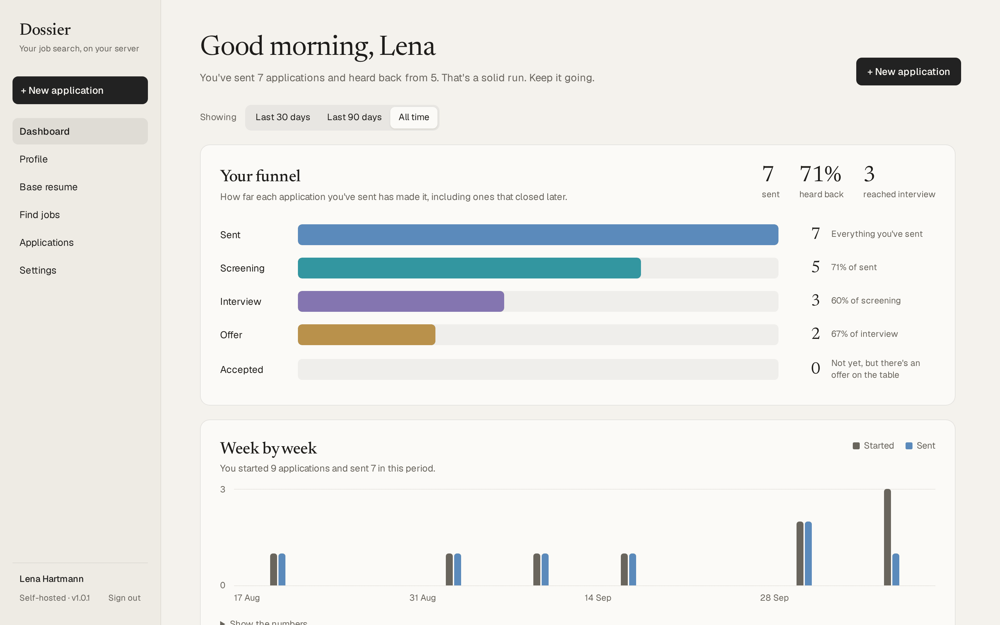
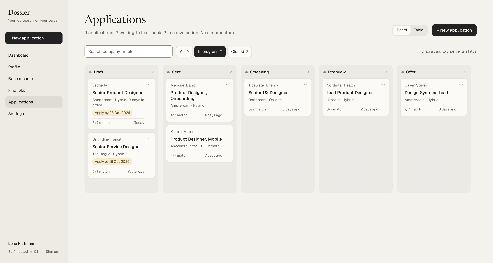
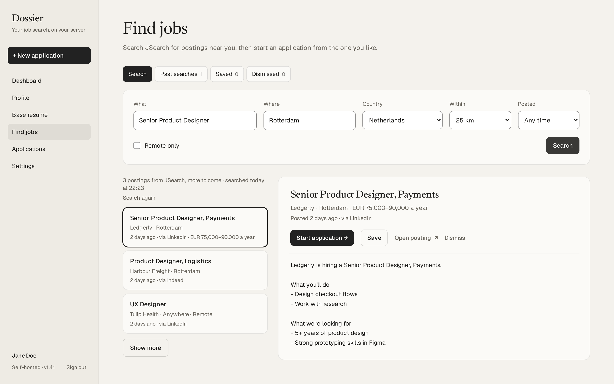
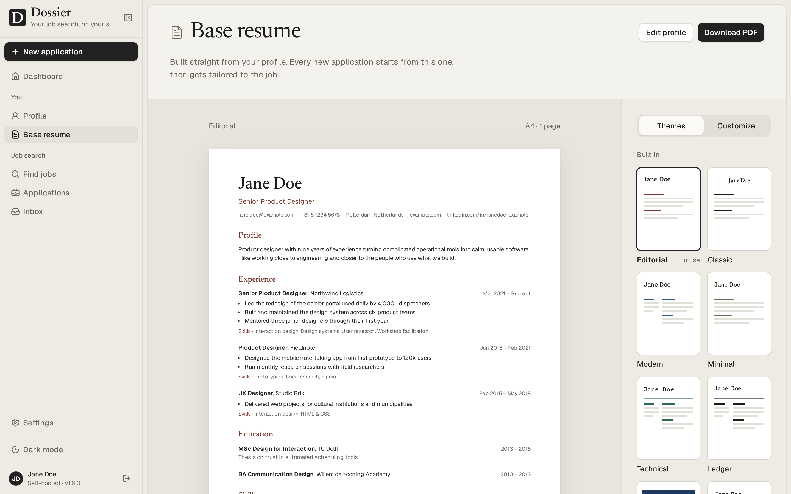
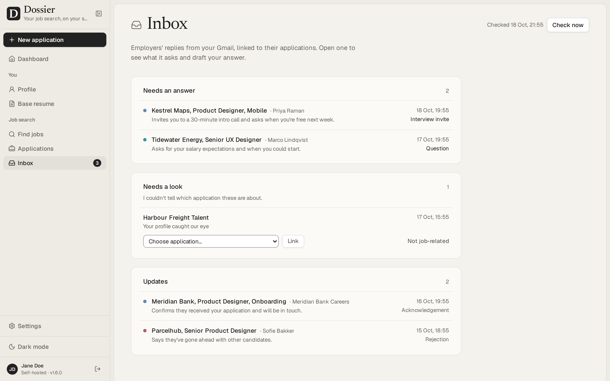
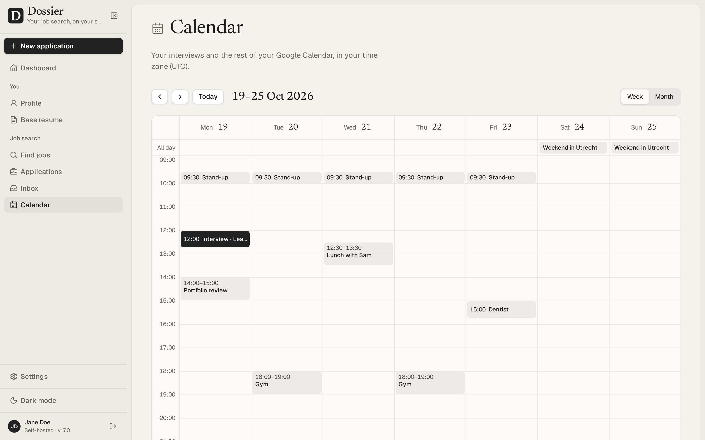

<p align="center">
  
</p>

<h1 align="center">HireMe</h1>

<p align="center">
  Your job search, on your own server: one profile, a tailored resume and cover letter for every job, and every application tracked from draft to offer.
</p>

<p align="center">
  <a href="https://github.com/shahzadafridi/HireMe/releases/latest"></a>
  <a href="https://github.com/shahzadafridi/HireMe/actions/workflows/image.yml"></a>
  <a href="LICENSE"></a>
  <a href="https://github.com/shahzadafridi/HireMe/pkgs/container/hireme"></a>
  
  
</p>

HireMe keeps your career history in one profile and turns it into a clean resume. For every job you apply to, it reads the posting, shows how you match, and drafts a tailored resume and cover letter that only use facts from your profile. You refine them in a chat, download them as PDFs and track each application from draft to offer.

It's for one person on a small server: one password, your data in your own PostgreSQL database (or a single SQLite file), and an AI model of your choice. That can be a local model through Ollama or LM Studio, so your profile and documents stay on your own hardware, or a hosted one (any OpenAI-compatible API, Anthropic or Mistral), which then receives what it writes from. [Privacy](https://github.com/shahzadafridi/HireMe/wiki/Privacy) says what goes where.

**Get started:** [run it on your computer](#run-it-on-your-computer) in a few minutes, or [self-host it](#self-hosting) on a server. The [installation guide](https://github.com/shahzadafridi/HireMe/wiki) covers every way: Docker with or without Compose, Node.js, a plain Ubuntu server, CapRover, Coolify and Dokploy.

**Or download the desktop app** for Windows or Linux from the [latest release](https://github.com/shahzadafridi/HireMe/releases/latest). It runs HireMe on your computer with nothing else to install, or opens a HireMe you host. See [Desktop app](https://github.com/shahzadafridi/HireMe/wiki/Desktop-app).

## Demo



<sub>Recorded with the demo data (Jane Doe is made up) and a stand-in AI server that answers at once, played at 1.2× speed. With a real model, reading a posting and writing the documents takes from a few seconds to a few minutes.</sub>

## Features

- **Profile:** basics, skills and languages, experience and volunteering, projects, education, certifications, publications and references, in the order you choose, with a strength meter that counts only what a profile needs. Projects (side, open-source, course or thesis work) show what you can do where your job titles don't yet. Certifications keep who issued them, their dates, credential ID and a link to verify them. Publications are cited in your own style, with bold and italics, and go on resumes word for word. Start it from an existing resume (PDF, Word or Markdown) if you like.
- **Base resume:** twelve themes and a theme builder, previewed live and printed to PDF on the server. Duplicate themes, or share them as files.
- **Find jobs:** search postings near your city, or anywhere you choose, through JSearch (LinkedIn, Indeed and more), Adzuna or FreeHire (company career pages). Save the good ones, dismiss the rest, score any of them against your profile, and start an application from a posting with one click.
- **Startups:** startups that are hiring, from YC startups' job posts and Hacker News' monthly “Who is hiring?” thread, kept to the ones that hire where you live or remotely from your country and ranked against your profile, with the address each one publishes for applications. HireMe reads their sites politely and follows their robots.txt. Start an application to one with a click; you decide whom to write to.
- **Job agent (optional):** save up to three named searches and run the enabled ones once a day, in order. It skips what you've seen, scores the new postings against your profile and keeps the best on the Agent screen, with its reasons and the searches that found them. The searches share one schedule, score/draft limits and a budget of three first-page source requests per rolling 24 hours (failed attempts count; the whole batch waits until it fits). It can prepare tailored drafts too, which wait for your review. It never sends or applies.
- **New application:** paste a posting; HireMe pulls out the details and requirements, matches them against your profile, and writes a tailored resume and cover letter in the tone you pick.
- **Never invents experience:** drafts only use facts from your profile. What the posting asks for and your profile doesn't have is shown as a gap, not made up.
- **Refine:** ask for changes in a chat, edit or regenerate any part (every part of the cover letter too: sender, date, recipient, greeting and sign-off, written in the letter's language), undo AI changes or go back to any earlier version, keep private notes.
- **Send:** an email to go with each application, to whoever the posting says to send it to, ready to copy or open in your mail app, with the resume and cover letter PDFs to attach. Edit, rewrite or refine it like the documents.
- **MCP connector (optional):** control your job search from OpenBot, Cursor, ChatGPT, Claude or another MCP client: search and save jobs, pull past searches, read your profile, create drafts, record applied jobs and rejections, update application details, archive and restore cards, and read dashboard totals and status history. Uses the existing OAuth sign-in at `/api/mcp`. Turn it on in Settings → MCP connector; see [MCP setup and tool reference](docs/mcp.md).
- **Gmail and Calendar (optional):** connect your Google account to send an application from your own address with its PDFs attached, see employers' replies next to each application, have the AI read what they ask and draft your answer from your profile, offer interview times you're free, and see your month and the week ahead on the dashboard, with interviews kept in step with Google Calendar both ways. Nothing is sent without your confirmation. Set it up by entering your Google OAuth client in Settings → Google, or with `HIREME_GOOGLE_CLIENT_ID` and `HIREME_GOOGLE_CLIENT_SECRET` (see [Connecting Gmail and Calendar](https://github.com/shahzadafridi/HireMe/wiki/Connecting-Gmail-and-Calendar)).
- **Track:** a board and a table of every application, and a dashboard with your funnel (last 30 days, 90 days or all time), a week-by-week chart, what's worth a look next, upcoming interviews included, and a calendar.
- **Your data:** export and import everything as one file, nightly backups, and Delete everything.

## Screenshots



<table>
  <tr>
    <td width="50%"><br>An application: the tailored resume, and a chat to refine it</td>
    <td width="50%"><br>A new application: how you match the posting</td>
  </tr>
  <tr>
    <td><br>Every application on a board, from draft to offer</td>
    <td><br>Find jobs and start an application from a posting</td>
  </tr>
  <tr>
    <td><br>The base resume, with twelve themes and a theme builder</td>
    <td><br>One profile that every resume and letter comes from</td>
  </tr>
  <tr>
    <td><br>Replies from Gmail, read by the AI, with answers it drafts</td>
    <td><br>Your interviews and Google Calendar on the dashboard, kept in step</td>
  </tr>
</table>

<sub>The screenshots show the demo data: Jane Doe is made up.</sub>

## Run it on your computer

All you need is [Docker Desktop](https://docs.docker.com/desktop/) on macOS or Windows, or Docker Engine with its Compose plugin on Linux, and about 2 GB of free memory. Run the commands in a terminal: macOS's Terminal, Linux, or WSL on Windows.

**1. Fetch the Compose file** into a folder of its own, and make the secrets HireMe needs:

```bash
mkdir ~/hireme && cd ~/hireme
curl -fsSL -o compose.yml https://raw.githubusercontent.com/shahzadafridi/HireMe/main/compose.production.yml
echo "POSTGRES_PASSWORD=$(openssl rand -hex 24)" > .env
echo "HIREME_SECRET=$(openssl rand -base64 32)" >> .env
```

**2. Choose your password.** This asks for it twice and prints a hash of it, one line that starts with `argon2id:`:

```bash
docker run --rm -it ghcr.io/shahzadafridi/hireme hash-password
```

Add that line to `.env` as `HIREME_PASSWORD=argon2id:…`, with any text editor. HireMe only keeps the hash, never the password.

**3. Start it:**

```bash
docker compose up -d
```

The first start downloads the image (about 1.7 GB) and sets up the database. Open [http://localhost:3000](http://localhost:3000), sign in with your password, and pick an AI model in **Settings → AI provider** (see [Choosing an AI provider](https://github.com/shahzadafridi/HireMe/wiki/Choosing-an-AI-provider)).

`docker compose stop` stops it and `docker compose start` starts it again, with your data kept.

**Without a database server:** HireMe can keep its data in an SQLite file instead, in one container. Put `DATABASE_URL=file:/data/hireme.db` in `.env` and run the image on its own, with a volume for `/data`:

```bash
docker run -d --name hireme --env-file .env -v hireme-data:/data -p 127.0.0.1:3000:3000 ghcr.io/shahzadafridi/hireme
```

Without that volume, the next upgrade deletes the data, and the container warns about it when it starts. To back up the file, stop the container and copy `hireme.db` out of the volume. PostgreSQL stays the better choice on a shared server; to move between the two, export your data in Settings → Your data and import it on the other. It's only reachable from your own computer. The [installation guide's Docker Compose page](https://github.com/shahzadafridi/HireMe/wiki/Run-locally-with-Docker-Compose) has more: another port, your time zone, upgrades and removing it.

## Self-hosting

To put HireMe on a server, on your own domain with HTTPS, follow the [installation guide](https://github.com/shahzadafridi/HireMe/wiki#self-host-on-a-server): a plain Ubuntu server with Docker Compose and Caddy (or Node.js, without Docker), CapRover, Coolify or Dokploy. Give the server at least 2 vCPUs and 2 GB of memory (see [Performance and sizing](#performance-and-sizing)).

## Documentation

The [wiki](https://github.com/shahzadafridi/HireMe/wiki) has what comes after installing:

- [Choosing an AI provider](https://github.com/shahzadafridi/HireMe/wiki/Choosing-an-AI-provider): a hosted model, or a local one with Ollama or LM Studio.
- [Choosing a job source](https://github.com/shahzadafridi/HireMe/wiki/Choosing-a-job-source): JSearch, Adzuna or FreeHire (and an unofficial one for Germany), and the job agent.
- [Connecting Gmail and Calendar](https://github.com/shahzadafridi/HireMe/wiki/Connecting-Gmail-and-Calendar): your own Google OAuth client, step by step.
- [Connecting Claude](https://github.com/shahzadafridi/HireMe/wiki/Connecting-Claude): the MCP connector, in Claude's apps and on the command line.
- [Backups and restore](https://github.com/shahzadafridi/HireMe/wiki/Backups-and-restore): exports, nightly backups and database dumps.
- <a name="upgrading"></a>[Upgrading](https://github.com/shahzadafridi/HireMe/wiki/Upgrading) to a new version.
- [Troubleshooting](https://github.com/shahzadafridi/HireMe/wiki/Troubleshooting): what the common errors mean, and what to do about them.
- [Privacy](https://github.com/shahzadafridi/HireMe/wiki/Privacy): what stays on your server and what leaves it. [PRIVACY.md](PRIVACY.md) has the details.
- [Environment variables](https://github.com/shahzadafridi/HireMe/wiki/Environment-variables): every setting the server reads.

## Known limitations

- **Desktop only:** made for a laptop or desktop browser, not for phones.
- **Single user:** one password and one profile; there are no accounts.
- **English interface:** the app itself is in English. Documents can be written in other languages; in the 21 built-in ones, their headings, dates and language levels are in that language too, and in one added with **Other language…** those stay in English.
- **One instance:** run a single copy of the app per database. The nightly backups, the AI job queue and the PDF browser live inside the app's process.

## Performance and sizing

Measured on 28 September 2026 with the production build in a container limited to 2 vCPUs and 1 GB:

- **PDFs:** the base resume renders in about 0.25 s, or 1 s when Chromium has to start first (it closes after five idle minutes). Two render at a time and the rest queue: six requested at once are done in 1.4 s. HireMe used at most about 520 MB, Chromium included, so give the container at least 768 MB.
- **Screens:** with ten times the demo data (90 applications), the dashboard and the applications list answer in 20–90 ms, and every query takes under a millisecond. With 900 applications they take up to about 0.2 s, mostly rendering; the tables are indexed for the queries they get.
- **Interactions** (changing a status, moving a card, switching tabs, opening an editor, typing, picking a theme) respond within 32 ms, and within about 100 ms on a CPU four times slower.

## Security

What protects your data, how to run HireMe safely and how to report a problem: see [SECURITY.md](SECURITY.md).

## Development

Working on HireMe itself: see [DEVELOPMENT.md](DEVELOPMENT.md).

## License

HireMe is free software under the [GNU Affero General Public License v3.0](LICENSE). You may use, change and share it; if you run a changed version for others over a network, you must offer them its source code.

### Apply with bot from a hosted HireMe

The application toolbar has a compact bot selector, **Apply with bot**, and
**Copy bot prompt**. Use **Bot settings** to preview the complete prompt for that
job in **Settings → Job agent → Application bots**. Choose Grok Bot, OpenBot,
Claude or another assistant, with separate handoff preferences and a default.
The optional shared **Prompt template** field controls the format for all bots.
Use placeholders such as `{{company}}`, `{{role}}`, `{{job_details}}`,
`{{application_url}}`, `{{drive_url}}` and `{{zip_url}}`. HireMe fills these with
the selected job’s data. Leave the field empty to use the generated prompt.
Required application context, file links, review and board-update instructions
are appended, or inserted where you put `{{default_prompt}}`.

OpenBot and other assistants use a clipboard handoff; paste the prompt into the
bot. Configure optional MCP access in **Settings → MCP connector**.

**Apply with bot** opens Grok Bot or Claude Desktop with a short prefilled
message containing the job’s current Drive snapshot, ZIP fallback and HireMe
tracking links. You review and send that message in the bot. Grok uses its
configured Bot ID, or your primary Bot when none is configured. The app must be
installed and signed in. OpenBot uses the optional local Mac helper described below; other apps use
clipboard handoff. The complete prompt is copied as a fallback.

`bot-prompt.md` stores the shared template filled with this application’s
context, plus optional preferences labelled by bot. In Drive it contains its
exact snapshot URL; ZIP packets contain the authenticated ZIP source link. The
opening message tells the bot to read that file, use Drive first and ZIP if
Drive is inaccessible, review every answer, and update the existing HireMe
card only after confirmed submission. Drive links remain private; the bot needs
your signed-in browser or its own authorized Drive connection. Template or
bot-preference changes produce a new snapshot when auto-save next checks the job.

The prompt includes the candidate's contact and profile links, job context,
posting and HireMe tracking URLs, and that job's current Drive packet link.
It tries Drive first, then the authenticated job-specific ZIP download if Drive
is missing or inaccessible. The ZIP is generated directly without a storage
server and contains `application.md`, `instructions.md`, and available PDFs.
Extract it into `~/Documents/hireme/apply/`, or attach it to the bot's chat.

The bot must verify the packet, use truthful answers, show every answer and
attachment, and obtain explicit approval before submitting. After confirmed
submission it must update the existing HireMe board card using an authorized
connector or signed-in browser, record evidence, and verify the update. If it
cannot update the board, it reports that step as pending and provides a note.
Failed or uncertain submissions must never be marked Sent.

### Keep application history in Google Drive

Enable **Google Drive API** in the Google Cloud project used by your HireMe
OAuth client. In **Settings → Google**, connect Drive with `drive.file`
permission. This is separate from Gmail and Calendar. The permission covers
files HireMe creates or that you explicitly authorize, rather than your whole
Drive. Create or find the HireMe folder there to browse the archive.

**Automatically save application packets** is on by default. Reviewed jobs with
a resume or cover letter are queued in the background when created, changed or
opened. Unchanged content is not uploaded twice. Turn auto-save off in Google
settings if desired. No manual Save to Google Drive button is needed.

```
HireMe/<company>-<role>-<YYYY-MM-DD>/<UTC timestamp and snapshot id>/
  application.md
  instructions.md
  bot-prompt.md
  resume.pdf          (when available)
  cover-letter.pdf    (when available)
```

The folder date is the application’s UTC creation date. ZIP filenames and their
internal folders use the same company-role-date name. Unsafe path characters
are replaced. Stable application IDs remain inside metadata and tracking links
to identify the exact card. Existing Drive job folders are renamed in place
when the next packet saves, keeping their history.

Each changed packet creates a dated snapshot; earlier versions stay in Drive.
The latest link is kept on the application without adding board notes or
changing application approvals. Failed uploads are labelled `(incomplete)`.
A red banner at the top reports connection or sync problems and links to Google
settings; job-specific failures offer retry. ZIP handoffs remain available.

Drive links are private by default: the bot needs your signed-in browser or its
own authorized Drive connection, and sharing a link does not grant access. Turn
on **Make snapshot links shareable** in Settings → Google → Google Drive when a
bot cannot reach your account; each new snapshot folder is then readable by
anyone holding its link, while the HireMe folder above it stays private. The
setting applies to snapshots saved after it changes — folders shared earlier
keep their sharing until you change it in Drive. Disconnecting Google or
deleting an application does not delete Drive archives; remove those in Drive
when needed. Snapshots describe documents, not proof of submission.

### Check setup and health

Open **Settings → Setup & health** for configuration checks covering your
profile, AI providers, job sources, scoring, document defaults, bots, Drive,
job agent, MCP access, mail, calendar, backups and hosting. Each item links to
its configuration section. Saved configuration and permissions are labelled
**Configured**; live checks are labelled separately. An API being configured
does not prove that its key, quota or service is healthy. Use the connection
test in the linked settings section where available.

### Direct OpenBot handoff from the live site

A hosted server cannot control a desktop app on your Mac. Install the local URL
handler once with `bash scripts/macos/install-bot-helper.sh`. It builds
**HireMe Bot Helper.app** in `~/Applications` and registers `hireme-bot://`.
Allow that app in macOS Settings → Privacy & Security → Accessibility once.
The installer signs the helper with this Mac’s Apple Development identity when
one exists, so rebuilding it keeps that permission instead of asking again.
No daemon, file-storage server, OpenBot API token or Local scripts permission is
needed. Node is not needed by the installed helper.

In Settings → Job agent → OpenBot, select **Open OpenBot and fill prompt (macOS)**
and set **OpenBot agent name** to the exact sidebar name (default: Job Manager).
Apply with bot is a normal browser app link, avoiding popup-window blocking.
It opens OpenBot, selects the named agent and pastes into its empty composer.
There is no separate helper review window or per-job script to run. You review
and press Send in OpenBot. The script never sends a message or presses Enter,
and refuses to overwrite an existing draft or type into another app.

Each bot is driven through its own agent control: OpenBot’s **Chat with …**
toggle opens the named chat, and Grok Bot’s sidebar agent (marked current by the
app) must already be selected. The helper pastes only into a composer that names
the requested agent, or — for Grok’s single generic Prompt box — only while that
agent is the current one; otherwise it stops and asks you to open the chat. A
press can be retried when a bot ignores it, but the helper never presses an agent
that already reports itself open, so it cannot toggle your chat shut.

Each bot also has an optional **app name**. Leave it empty to open the bot’s
default app, or the copy that is already running; set it when the app is
installed under another name (for example a beta). The first time a name resolves
to an app HireMe has not pasted into before, the helper asks you once and
remembers the answer, because a link must never be able to type into an app you
did not choose.

The browser copies the complete template-based prompt. The helper uses that
clipboard text only when it matches this exact HireMe application; otherwise
it uses the short Drive-first/ZIP-fallback message embedded in the link. It
restores the clipboard after pasting. Each new computer needs its own one-time
helper/Accessibility setup; devices without it can use Copy bot prompt.

Grok uses its supported single-line prompt link. Keep the composer empty and
allow the browser’s Open Grok Bot prompt. It preserves existing drafts.

Inbox connection status is independent of automatic Gmail checks. Turning
those checks off keeps manual Check now available. A Google account connected
only for Drive/Calendar is shown as connected, with a specific Gmail read-access
request rather than a misleading reconnect message.

The same Mac helper also supports Grok Bot. In Settings → Job agent → Grok Bot, choose “Open Grok Bot and fill prompt (macOS)” and enter the exact sidebar name (for example, Job Finder). It uses the helper’s existing Accessibility permission. Native app links remain available on other devices. Both helper modes preserve existing drafts and leave Send to you.
