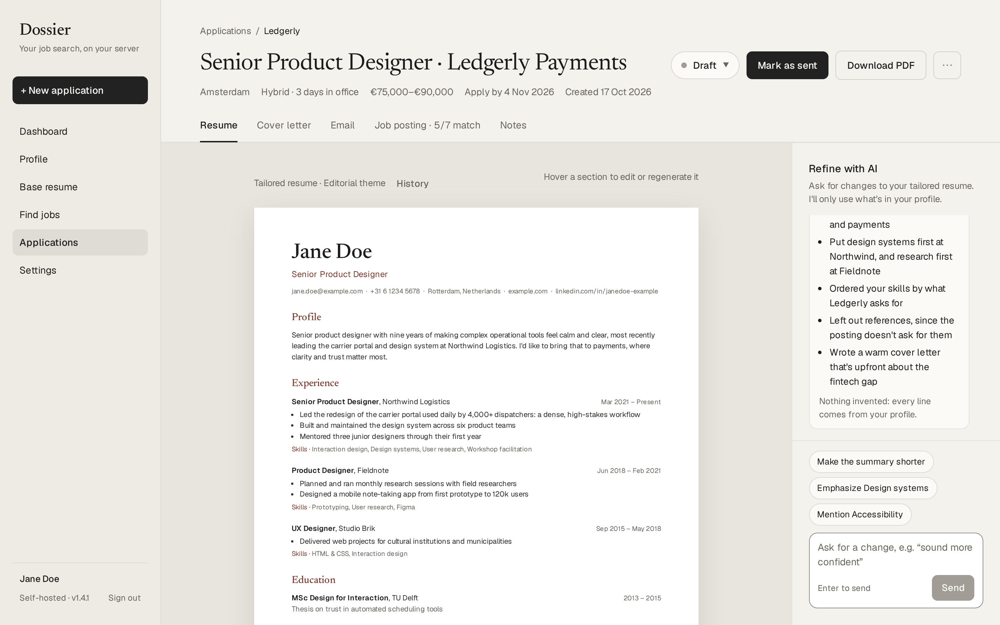
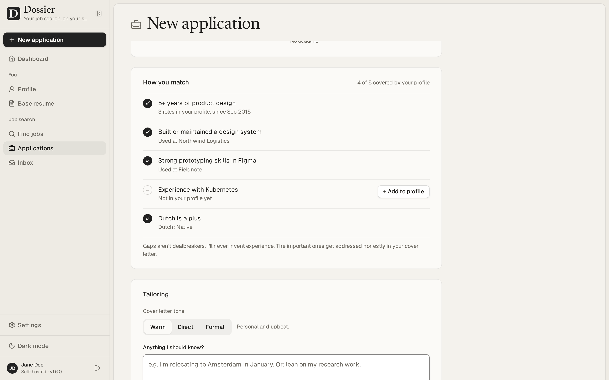
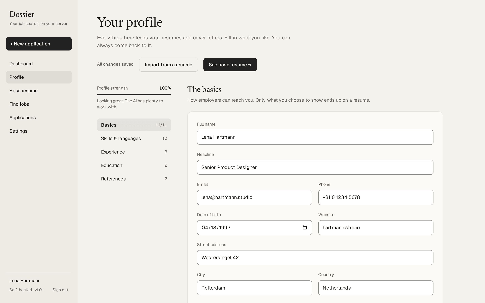

<p align="center">
  
</p>

<h1 align="center">HireMe</h1>

<p align="center">
  Your job search, on your own server: one profile, a tailored resume and cover letter for every job, and every application tracked from draft to offer.
</p>

<p align="center">
  <a href="https://github.com/shahzadafridi/HireMe/releases/latest"></a>
  <a href="https://github.com/shahzadafridi/HireMe/actions/workflows/image.yml"></a>
  <a href="LICENSE"></a>
  <a href="https://github.com/shahzadafridi/HireMe/pkgs/container/hireme"></a>
  
  
</p>

HireMe keeps your career history in one profile and turns it into a clean resume. For every job you apply to, it reads the posting, shows how you match, and drafts a tailored resume and cover letter that only use facts from your profile. You refine them in a chat, download them as PDFs and track each application from draft to offer.

It's for one person on a small server: one password, your data in your own PostgreSQL database (or a single SQLite file), and an AI model of your choice. That can be a local model through Ollama or LM Studio, so your profile and documents stay on your own hardware, or a hosted one (any OpenAI-compatible API, Anthropic or Mistral), which then receives what it writes from. [Privacy](https://github.com/shahzadafridi/HireMe/wiki/Privacy) says what goes where.

**Get started:** [run it on your computer](#run-it-on-your-computer) in a few minutes, or [self-host it](#self-hosting) on a server. The [installation guide](https://github.com/shahzadafridi/HireMe/wiki) covers every way: Docker with or without Compose, Node.js, a plain Ubuntu server, CapRover, Coolify and Dokploy.

**Or download the desktop app** for Windows or Linux from the [latest release](https://github.com/shahzadafridi/HireMe/releases/latest). It runs HireMe on your computer with nothing else to install, or opens a HireMe you host. See [Desktop app](https://github.com/shahzadafridi/HireMe/wiki/Desktop-app).

## Demo


<sub>Recorded with the demo data (Jane Doe is made up) and a stand-in AI server that answers at once, played at 1.2× speed. With a real model, reading a posting and writing the documents takes from a few seconds to a few minutes.</sub>

## Features

- **Profile:** basics, skills and languages, experience and volunteering, projects, education, certifications, publications and references, in the order you choose, with a strength meter that counts only what a profile needs. Projects (side, open-source, course or thesis work) show what you can do where your job titles don't yet. Certifications keep who issued them, their dates, credential ID and a link to verify them. Publications are cited in your own style, with bold and italics, and go on resumes word for word. Start it from an existing resume (PDF, Word or Markdown) if you like.
- **Base resume:** twelve themes and a theme builder, previewed live and printed to PDF on the server. Duplicate themes, or share them as files.
- **Find jobs:** search postings near your city, or anywhere you choose, through JSearch (LinkedIn, Indeed and more), Adzuna or FreeHire (company career pages). Save the good ones, dismiss the rest, score any of them against your profile, and start an application from a posting with one click.
- **Startups:** startups that are hiring, from YC startups' job posts and Hacker News' monthly “Who is hiring?” thread, kept to the ones that hire where you live or remotely from your country and ranked against your profile, with the address each one publishes for applications. HireMe reads their sites politely and follows their robots.txt. Start an application to one with a click; you decide whom to write to.
- **Job agent (optional):** save up to three named searches and run the enabled ones once a day, in order. It skips what you've seen, scores the new postings against your profile and keeps the best on the Agent screen, with its reasons and the searches that found them. The searches share one schedule, score/draft limits and a budget of three first-page source requests per rolling 24 hours (failed attempts count; the whole batch waits until it fits). It can prepare tailored drafts too, which wait for your review. It never sends or applies.
- **New application:** paste a posting; HireMe pulls out the details and requirements, matches them against your profile, and writes a tailored resume and cover letter in the tone you pick.
- **Never invents experience:** drafts only use facts from your profile. What the posting asks for and your profile doesn't have is shown as a gap, not made up.
- **Refine:** ask for changes in a chat, edit or regenerate any part (every part of the cover letter too: sender, date, recipient, greeting and sign-off, written in the letter's language), undo AI changes or go back to any earlier version, keep private notes.
- **Send:** an email to go with each application, to whoever the posting says to send it to, ready to copy or open in your mail app, with the resume and cover letter PDFs to attach. Edit, rewrite or refine it like the documents.
- **MCP connector (optional):** control your job search from OpenBot, Cursor, ChatGPT, Claude or another MCP client: search and save jobs, pull past searches, read your profile, create drafts, record applied jobs and rejections, update application details, archive and restore cards, and read dashboard totals and status history. Uses the existing OAuth sign-in at `/api/mcp`. Turn it on in Settings → MCP connector; see [MCP setup and tool reference](docs/mcp.md).
- **Gmail and Calendar (optional):** connect your Google account to send an application from your own address with its PDFs attached, see employers' replies next to each application, have the AI read what they ask and draft your answer from your profile, offer interview times you're free, and see your month and the week ahead on the dashboard, with interviews kept in step with Google Calendar both ways. Nothing is sent without your confirmation. Set it up by entering your Google OAuth client in Settings → Google, or with `HIREME_GOOGLE_CLIENT_ID` and `HIREME_GOOGLE_CLIENT_SECRET` (see [Connecting Gmail and Calendar](https://github.com/shahzadafridi/HireMe/wiki/Connecting-Gmail-and-Calendar)).
- **Track:** a board and a table of every application, and a dashboard with your funnel (last 30 days, 90 days or all time), a week-by-week chart, what's worth a look next, upcoming interviews included, and a calendar.
- **Application packets:** every job becomes one folder a bot can read: the tailored PDFs, the posting, the standard answers and the review rules, as a private ZIP download or a dated snapshot in your own Google Drive. The link is in the prompt, so nothing has to be carried between apps by hand.
- **Apply with a bot:** choose Grok Bot, OpenBot, Claude or another assistant, per job or as a default. Each keeps its own handoff preferences, and one optional prompt template with placeholders controls the format everywhere. On a Mac, the helper fills the chosen bot's composer for you and never presses Send.
- **Reviewed connector actions (optional):** an MCP app can ask you, once per action, to send an email, delete an application or hand an approved packet to an external submission. Each review freezes what it will do, and revoking access or editing the card cancels it.
- **Setup & health:** one page that says which parts are configured, which were checked live, and where to fix what's missing.
- **Your data:** export and import everything as one file, nightly backups, and Delete everything.

## Screenshots


<table>
  <tr>
    <td width="50%"><br>An application: the tailored resume, and a chat to refine it</td>
    <td width="50%"><br>A new application: how you match the posting</td>
  </tr>
  <tr>
    <td><br>Every application on a board, from draft to offer</td>
    <td><br>Find jobs and start an application from a posting</td>
  </tr>
  <tr>
    <td><br>The base resume, with twelve themes and a theme builder</td>
    <td><br>One profile that every resume and letter comes from</td>
  </tr>
  <tr>
    <td><br>Replies from Gmail, read by the AI, with answers it drafts</td>
    <td><br>Your interviews and Google Calendar on the dashboard, kept in step</td>
  </tr>
</table>

<sub>The screenshots show the demo data: Jane Doe is made up.</sub>

## Run it on your computer

All you need is [Docker Desktop](https://docs.docker.com/desktop/) on macOS or Windows, or Docker Engine with its Compose plugin on Linux, and about 2 GB of free memory. Run the commands in a terminal: macOS's Terminal, Linux, or WSL on Windows.

**1. Fetch the Compose file** into a folder of its own, and make the secrets HireMe needs:

```bash
mkdir ~/hireme && cd ~/hireme
curl -fsSL -o compose.yml https://raw.githubusercontent.com/shahzadafridi/HireMe/main/compose.production.yml
echo "POSTGRES_PASSWORD=$(openssl rand -hex 24)" > .env
echo "HIREME_SECRET=$(openssl rand -base64 32)" >> .env
```

**2. Choose your password.** This asks for it twice and prints a hash of it, one line that starts with `argon2id:`:

```bash
docker run --rm -it ghcr.io/shahzadafridi/hireme hash-password
```

Add that line to `.env` as `HIREME_PASSWORD=argon2id:…`, with any text editor. HireMe only keeps the hash, never the password.

**3. Start it:**

```bash
docker compose up -d
```

The first start downloads the image (about 1.7 GB) and sets up the database. Open [http://localhost:3000](http://localhost:3000), sign in with your password, and pick an AI model in **Settings → AI provider** (see [Choosing an AI provider](https://github.com/shahzadafridi/HireMe/wiki/Choosing-an-AI-provider)).

`docker compose stop` stops it and `docker compose start` starts it again, with your data kept.

**Without a database server:** HireMe can keep its data in an SQLite file instead, in one container. Put `DATABASE_URL=file:/data/hireme.db` in `.env` and run the image on its own, with a volume for `/data`:

```bash
docker run -d --name hireme --env-file .env -v hireme-data:/data -p 127.0.0.1:3000:3000 ghcr.io/shahzadafridi/hireme
```

Without that volume, the next upgrade deletes the data, and the container warns about it when it starts. To back up the file, stop the container and copy `hireme.db` out of the volume. PostgreSQL stays the better choice on a shared server; to move between the two, export your data in Settings → Your data and import it on the other. It's only reachable from your own computer. The [installation guide's Docker Compose page](https://github.com/shahzadafridi/HireMe/wiki/Run-locally-with-Docker-Compose) has more: another port, your time zone, upgrades and removing it.

## Self-hosting

To put HireMe on a server, on your own domain with HTTPS, follow the [installation guide](https://github.com/shahzadafridi/HireMe/wiki#self-host-on-a-server): a plain Ubuntu server with Docker Compose and Caddy (or Node.js, without Docker), CapRover, Coolify or Dokploy. Give the server at least 2 vCPUs and 2 GB of memory (see [Performance and sizing](#performance-and-sizing)).

## Documentation

The [wiki](https://github.com/shahzadafridi/HireMe/wiki) has what comes after installing. It is being carried over from the upstream wiki, which documents the same screens while it is:

- [Choosing an AI provider](https://github.com/shahzadafridi/HireMe/wiki/Choosing-an-AI-provider): a hosted model, or a local one with Ollama or LM Studio.
- [Choosing a job source](https://github.com/shahzadafridi/HireMe/wiki/Choosing-a-job-source): JSearch, Adzuna or FreeHire (and an unofficial one for Germany), and the job agent.
- [Connecting Gmail and Calendar](https://github.com/shahzadafridi/HireMe/wiki/Connecting-Gmail-and-Calendar): your own Google OAuth client, step by step.
- [Connecting Claude](https://github.com/shahzadafridi/HireMe/wiki/Connecting-Claude): the MCP connector, in Claude's apps and on the command line.
- [Backups and restore](https://github.com/shahzadafridi/HireMe/wiki/Backups-and-restore): exports, nightly backups and database dumps.
- <a name="upgrading"></a>[Upgrading](https://github.com/shahzadafridi/HireMe/wiki/Upgrading) to a new version.
- [Troubleshooting](https://github.com/shahzadafridi/HireMe/wiki/Troubleshooting): what the common errors mean, and what to do about them.
- [Privacy](https://github.com/shahzadafridi/HireMe/wiki/Privacy): what stays on your server and what leaves it. [PRIVACY.md](PRIVACY.md) has the details.
- [Environment variables](https://github.com/shahzadafridi/HireMe/wiki/Environment-variables): every setting the server reads.

## Hosted installs

HireMe runs as a single process by default: the request that starts an AI job returns at once, and the work continues inside that process, along with the nightly backups, the inbox checks and the job agent. That is right for a laptop or one server, and the [installation guide](https://github.com/shahzadafridi/HireMe/wiki) covers it.

A container platform that sleeps or scales can end that process mid-job. Set `HIREME_RUNTIME` to split the work instead:

- `HIREME_RUNTIME=web` answers requests and starts nothing on its own. When an interactive job is queued, it wakes the worker.
- `HIREME_RUNTIME=worker` owns the queue, the schedules and startup recovery. One instance holds a database lock, so a restart never runs two leaders at once, and it needs `DATABASE_URL_UNPOOLED` (a direct connection; a transaction pooler cannot hold a session lock).
- Leave `HIREME_RUNTIME` unset and the desktop behaviour is unchanged.

The worker stays up during a nightly window and stops outside it unless work is queued, which keeps a small plan's usage bounded. Everything is configuration, nothing is tied to one provider: `HIREME_WORKER_WINDOW_START` and `HIREME_WORKER_WINDOW_END` set the window in UTC hours, and a platform that offers a worker daemon and its API takes `HIREME_WORKER_VERCEL_TOKEN`, `HIREME_WORKER_PROJECT_ID`, `HIREME_WORKER_TEAM_ID`, `HIREME_WORKER_DAEMON` and `HIREME_WORKER_REGION`. Without those, leave the runtime unset and run one process.

If the worker cannot start, the job is marked failed with a Retry, and its input is kept. Nothing is lost silently, and the website stays up while the worker is down.

## Applying through a bot

The application toolbar has a compact bot selector, **Apply with bot** and **Copy bot prompt**. **Settings → Job agent → Application bots** is where each bot is set up: choose a default, write handoff preferences per bot, and edit one shared **Prompt template** for all of them.

The template is optional. Write it in your own words and use `{{company}}`, `{{role}}`, `{{job_details}}`, `{{location}}`, `{{salary}}`, `{{posting_url}}`, `{{application_url}}`, `{{application_id}}`, `{{drive_url}}`, `{{zip_url}}`, `{{candidate}}`, `{{bot}}` and `{{packet_folder}}`; HireMe fills them from the selected job. Put `{{default_prompt}}` where the complete generated context should go, or leave it out and it is appended. The required parts — the packet links, the private-file rules, the approval rule and the board update — are always included, so a template can change the wording but cannot drop them.

**Apply with bot** opens the chosen app with a short message holding that job's current Drive snapshot, its ZIP fallback and the HireMe card link, and copies the complete prompt as a fallback. Grok Bot and Claude Desktop accept a prefilled message; review it there and press Send yourself. OpenBot has no such link, so it uses the local helper below, or the clipboard.

The prompt tells the bot to read `bot-prompt.md` first, then `application.md` and `instructions.md`, to use Drive when it can reach it and the ZIP when it cannot, to show every answer and attachment for review, never to submit without an explicit OK, and — after a confirmed submission — to update this exact HireMe card and verify the update. A packet is never treated as proof that a job was submitted.

### The macOS helper

A hosted HireMe cannot type into an application on your Mac, and neither Grok Bot nor OpenBot accepts a prefilled prompt from a web page. The helper closes that gap:

```
bash scripts/macos/install-bot-helper.sh
```

It builds **HireMe Bot Helper.app** in `~/Applications` and registers the `hireme-bot://` link. Allow it once in **System Settings → Privacy & Security → Accessibility**; the installer signs it with the Mac's Apple Development identity when one exists, so rebuilding it keeps that permission. No daemon, storage service, bot API token or Local scripts permission is involved, and Node is not needed after installing.

In **Settings → Job agent**, choose **Open OpenBot and fill prompt (macOS)** or **Open Grok Bot and fill prompt (macOS)** and give the exact agent name — OpenBot's sidebar name (default Job Manager) or Grok Bot's (default Job Finder). There is no separate review window and no script per job: Apply with bot opens the app, selects that agent and pastes into its empty composer. You read it and press Send.

Each bot is driven through its own control. OpenBot's **Chat with …** toggle opens the named chat; Grok Bot's sidebar item must report itself current for its single generic prompt box to be used. The helper pastes only into a composer that names the requested agent, or into Grok's one box while that agent is current; otherwise it stops and asks you to open the chat. A press is retried when a bot ignores it, but never while the agent already reports itself open, so a chat is never toggled shut.

Each bot also has an optional **app name**, for a beta build, a renamed copy or an install outside `/Applications`. Leave it empty to open the bot's default app or the copy already running. The first time a name resolves to an app HireMe has not pasted into before, the helper asks once and remembers the answer — a link must never be able to type into an app you did not choose. It never presses Return, never sends, and refuses to overwrite an existing draft. It restores your clipboard after pasting.

On any other computer, **Copy bot prompt** works the same way; the helper is a convenience, not a requirement.

## Application packets and Google Drive

A packet is one folder per application, named `Company-Role-YYYY-MM-DD`, holding `resume.pdf` and `cover-letter.pdf` when they exist, `application.md` (posting, match, standard answers, document text), `instructions.md` and `bot-prompt.md`. The ZIP download is generated inside an authenticated request from HireMe's own storage, so a hosted install with no shared disk still serves it and no CV ever sits at a public URL. A job can only rewrite its own folder.

**Settings → Google → Google Drive** keeps a dated copy of each packet in your own Drive:

```
HireMe/<company>-<role>-<YYYY-MM-DD>/<UTC timestamp and snapshot id>/
  application.md
  instructions.md
  bot-prompt.md
  resume.pdf          (when available)
  cover-letter.pdf    (when available)
```

Enable the **Google Drive API** in the Google Cloud project behind your OAuth client, then connect Drive with the `drive.file` scope: HireMe sees only files it created or that you shared with it, not your whole Drive. Auto-save is on by default and runs in the background when an application is created or its documents change; unchanged packets are not uploaded twice, and a failed upload is labelled `(incomplete)` and reported in a banner. Earlier snapshots are kept, the newest link is recorded on the card, and the older ones are still reachable in Drive.

Drive links are private by default: a bot needs your signed-in browser or its own authorized Drive connection. Turn on **Make snapshot links shareable** when a bot cannot reach your account — each new snapshot folder then becomes readable by anyone holding its link, while the HireMe folder above it stays private. It applies to snapshots saved after the change; folders shared earlier keep their sharing until you change them in Drive. Disconnecting Google or deleting an application does not delete Drive files.

## Setup and health

**Settings → Setup & health** lists every requirement in one place: profile, AI providers, job sources, scoring, document defaults, bots, Drive, the job agent, MCP access, mail, calendar, backups and hosting. Each item says whether it is configured and links to the exact section that fixes it. Saved configuration and permissions are labelled **Configured**; checks that actually call a service are labelled separately, because a saved key does not prove a working one.

## Known limitations

- **Desktop only:** made for a laptop or desktop browser, not for phones.
- **Single user:** one password and one profile; there are no accounts.
- **English interface:** the app itself is in English. Documents can be written in other languages; in the 21 built-in ones, their headings, dates and language levels are in that language too, and in one added with **Other language…** those stay in English.
- **One instance:** a desktop or single-process install runs one copy per database. The nightly backups, the AI job queue and the PDF browser live inside its process. A hosted install can split them: `HIREME_RUNTIME=web` containers answer requests, and one `HIREME_RUNTIME=worker` container owns the queue and the schedules.

## Performance and sizing

Measured on 28 September 2026 with the production build in a container limited to 2 vCPUs and 1 GB:

- **PDFs:** the base resume renders in about 0.25 s, or 1 s when Chromium has to start first (it closes after five idle minutes). Two render at a time and the rest queue: six requested at once are done in 1.4 s. HireMe used at most about 520 MB, Chromium included, so give the container at least 768 MB.
- **Screens:** with ten times the demo data (90 applications), the dashboard and the applications list answer in 20–90 ms, and every query takes under a millisecond. With 900 applications they take up to about 0.2 s, mostly rendering; the tables are indexed for the queries they get.
- **Interactions** (changing a status, moving a card, switching tabs, opening an editor, typing, picking a theme) respond within 32 ms, and within about 100 ms on a CPU four times slower.

## Security

What protects your data, how to run HireMe safely and how to report a problem: see [SECURITY.md](SECURITY.md).

## Development

Working on HireMe itself: see [DEVELOPMENT.md](DEVELOPMENT.md).

## License

HireMe is free software under the [GNU Affero General Public License v3.0](LICENSE). You may use, change and share it; if you run a changed version for others over a network, you must offer them its source code.

HireMe continues the project it was forked from, under the same AGPL-3.0. [NOTICE](NOTICE) records that project, its copyright, what changed and where this source is published.
